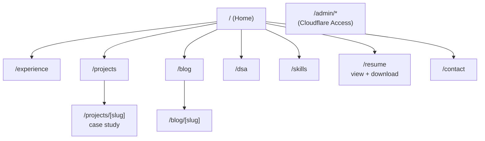
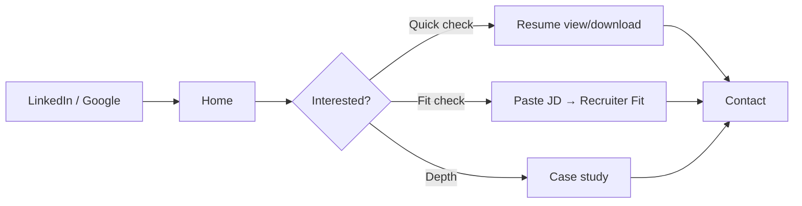
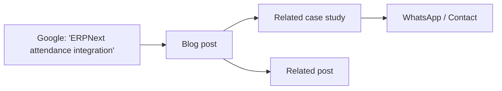
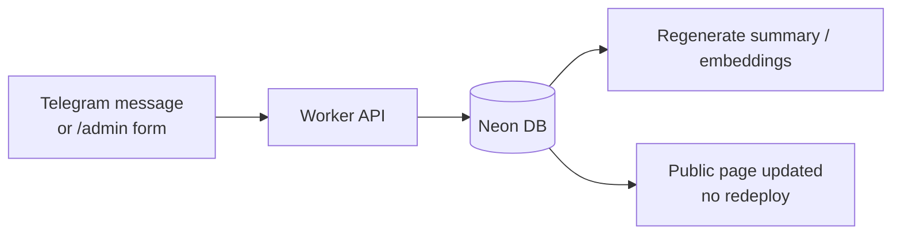
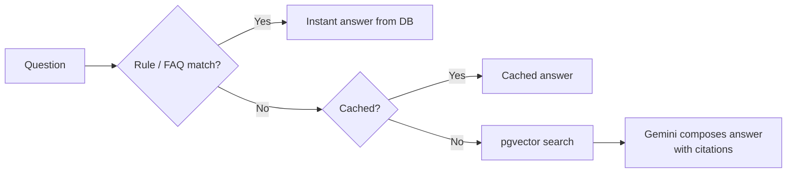

# Information Architecture & User Flows

- **Status:** Draft v0.1
- **Last updated:** 2026-11-18
- **Related:** [PRD](01-prd.md)

## 1. Principles
1. **Home = summary, detail pages = depth.** Home shows a short heading + 1–3 highlights per section, each with a "View all →" link. Full detail lives only on its own page.
2. **Proof first.** The two highest-priority sections are **Today / This week** (live proof of work) and **Case studies** (proof of judgment).
3. **Every page ends with a next step** (contact, resume, related content). No dead ends.
4. **Mobile-first.** Every flow must work one-handed on a phone.

## 2. Sitemap

## 3. Home page (top → bottom)
| # | Section | On home | Links to |
|---|---|---|---|
| 1 | **Hero** | Name, one-line positioning, buttons: Resume · Contact | `/resume`, `/contact` |
| 2 | **Today / This week** ⭐ | Latest GitHub summary + DSA solved/revised today | `/dsa`, GitHub |
| 3 | **Case studies** ⭐ | 2–3 cards: title, one-line problem, one-line outcome | `/projects/[slug]`, `/projects` |
| 4 | **Experience** | Company · role · dates · one line each | `/experience` |
| 5 | **Skills** | Top skills as chips with a short "built with it" note | `/skills` |
| 6 | **Latest blogs** | 3 post titles + date | `/blog/[slug]`, `/blog` |
| 7 | **Ask Karan's AI / Recruiter Fit** | Input box + 2–3 suggested questions | opens chat |
| 8 | **Footer** | Contact, WhatsApp, GitHub, LinkedIn | — |

## 4. Detail pages
| Page | Contains |
|---|---|
| `/experience` | Full timeline. Per company: role, dates, responsibilities, implementations, tools, impact, links to related case studies |
| `/projects` | All projects, filter by tech/status |
| `/projects/[slug]` | Case study: Problem → Constraints (cost, team, security) → Options → Decision → Outcome → What AI got wrong → Screenshots → Links |
| `/blog`, `/blog/[slug]` | Posts with tags, TL;DR, related posts, CTA to contact |
| `/dsa` | Heatmap, topic split, today's solved/revised with "how I thought" notes |
| `/skills` | Per skill: what I know → what I built → how I use AI → how to use AI securely |
| `/resume` | Inline PDF viewer + download (both counted) |
| `/contact` | Form (Turnstile) + WhatsApp button |

## 5. Key flows

### 5.1 Recruiter (primary)

### 5.2 Blog reader / MSME client

### 5.3 Admin (Karan)

### 5.4 Ask Karan's AI

## 6. Decisions
- **Audience:** recruiters and MSME clients carry **equal weight**. The hero speaks to both: outcomes for a business, plus the engineering behind them for a recruiter. The hero has two CTAs: **Resume** (recruiter) and **Talk to me / WhatsApp** (client).
- **Home case studies (in order):**
  1. **Tally → ERPNext migration**: moving full historical data from Tally into ERPNext.
  2. **Unified internal portal**: bringing all internal APIs (OnTime attendance, ERPNext, Lystloc, …) into one dashboard to cut daily time spent switching tools.
  3. **WhatsApp Business without a third party**: direct Meta Cloud API integration in a few steps, with no middleman cost.

- **Hero line:** *"Factories run on Excel, Tally and hope. I replace two of those."*

## 7. Case-study disclosure rules
| ✅ Share | ❌ Never share |
|---|---|
| Years of data migrated | Company-specific / vital business data |
| Cost saved (₹ or %) | Internal process flows, approval chains |
| Time to build | Credentials, endpoints, internal URLs, screenshots with real data |
| Generic architecture (e.g. Tally → transform → ERPNext) | Customer/vendor names without permission |

Diagrams in case studies show **common, industry-standard flows** only.
